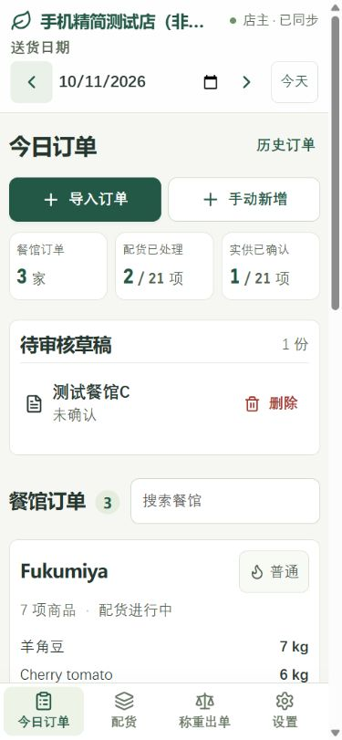
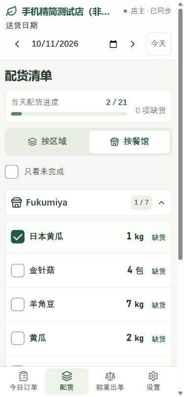
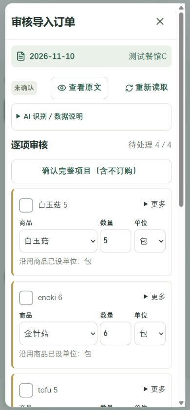
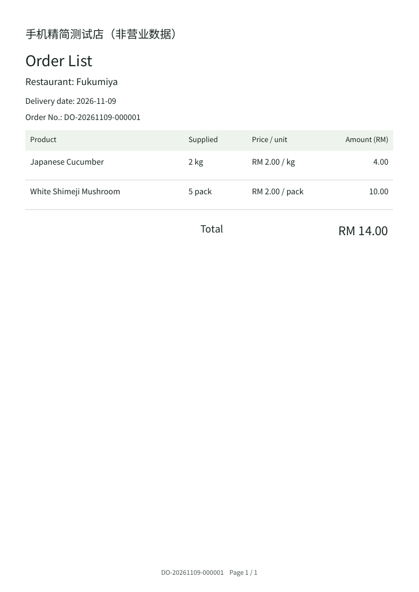
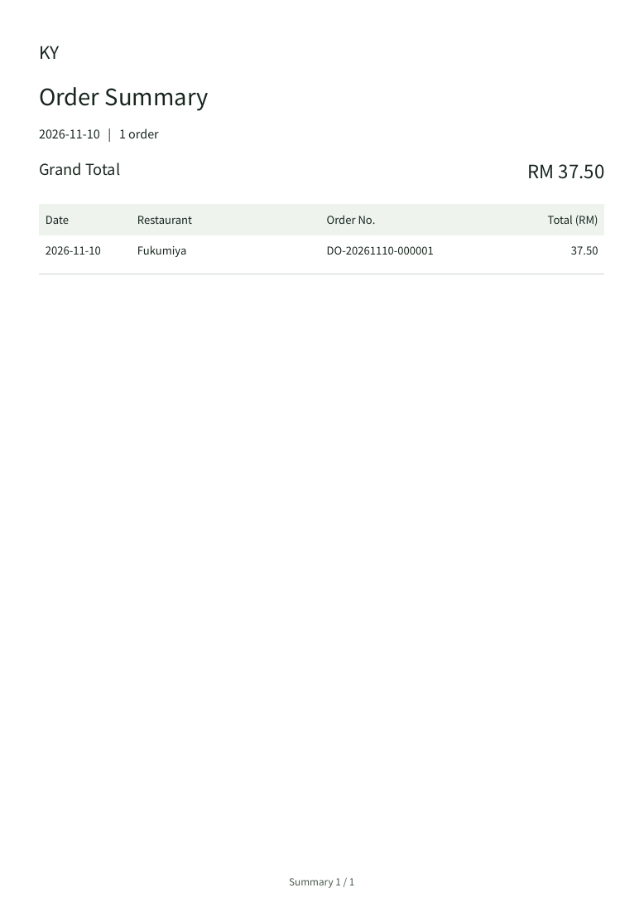
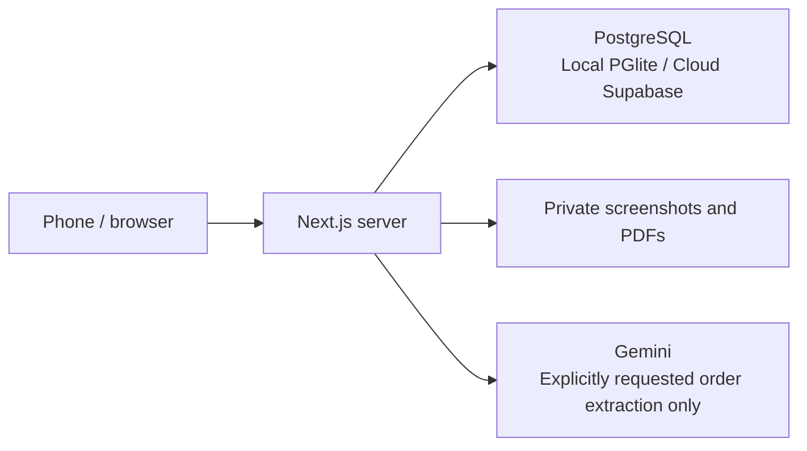

<p align="center">
  
</p>

# ShopHelper

[简体中文](README.md) | **English**

A mobile web app for restaurant orders, produce picking, weighing, and delivery documents, built for a small fresh-food shop.

Turn restaurant messages and screenshots into reviewed orders, pick items by zone or restaurant, then calculate charges from the quantities actually supplied and generate Chinese or English PDFs. The app is designed for Chinese-speaking users, with large buttons, simple lists, adjustable text sizes, and separate accounts for four people working together.

**Text / screenshot → Human review → Picking → Supplied quantities → Order List**

## Why I built this

My parents raised us by running a small shop selling vegetables and fish. Growing up, I knew they worked hard to support the family, leaving early and coming home late. But I did not really understand what their work involved. A few weeks ago, my dad mentioned that an employee would be taking a day off and the shop would be short-staffed. I was on a school break, so I offered to help for a day. That day gave me the idea for this project.

I experienced the whole process: reading restaurant orders, picking items, weighing them, and writing bills by hand. There was a lot of copying, checking, and calculating. My dad typed the picking list on his phone and sent it to me on WhatsApp. The items were not arranged in any particular order, and because I did not know where everything was kept, I had to search from one end of the shop to the other. Handwritten bills also left room for calculation mistakes.

I wanted to bring these tasks together in a simple phone app so my parents could spend less time copying orders and calculating bills, and everyone could check orders together more easily. The number of features matters less to me than whether they can pick up their phones and understand what to do—especially when the shop is busy. I hope it saves them a little time and makes their work a little easier.

## Screenshots

These examples use an isolated test shop with demonstration data. They contain no real business orders or login credentials. The app interface is in Chinese; the English option applies to generated documents.

<table>
  <tr>
    <td align="center"><strong>Today's orders</strong></td>
    <td align="center"><strong>Picking list</strong></td>
    <td align="center"><strong>Import review</strong></td>
  </tr>
  <tr>
    <td></td>
    <td></td>
    <td></td>
  </tr>
</table>

<details>
<summary>View an English Order List and date-range summary</summary>

<table>
  <tr>
    <td align="center"><strong>English Order List</strong></td>
    <td align="center"><strong>Summary at the start of a merged PDF</strong></td>
  </tr>
  <tr>
    <td></td>
    <td></td>
  </tr>
</table>

</details>

## Features

| Feature | How it works |
| --- | --- |
| Restaurant orders | Enter orders by delivery date and maintain products, restaurants, zones, and aliases. |
| Text and screenshot imports | Parse straightforward text with rules first; explicitly use Gemini when needed. Both input types share the same review workflow. |
| Human review | Keep the source text or image, correct extraction results, and confirm each item or mark it as not ordered. Drafts can be deleted and restored. |
| Picking | Browse by zone or restaurant. Groups start collapsed; tap to expand. Each restaurant shows one list sorted by zone. |
| Weighing and billing | Confirm picking and supplied quantities separately. Calculate charges from actual quantities and saved order prices. |
| Chinese and English documents | Preview, download, and manually share A4 PDFs. Owners maintain English product names; missing names prompt a correction. |
| Historical PDF merging | Choose one day or a date range and merge the latest finalized documents. The first page lists document amounts and the grand total by default. |
| Four-person access | Separate accounts, synchronized updates, and server-side permissions. Conflicts prompt a review while preserving unsubmitted input. |
| Backup and restore | Export business data as JSON and validate it before restoring, including historical prices, document versions, and original PDFs. |

Text sizes are Standard, Large, and Extra Large, with Large as the default. Expanding or collapsing a picking group only changes the current phone's view, not anyone else's view or task status.

The core shared-shop workflow is implemented through Stages 1–4. Stage 5 staff task assignment is not implemented. The app does not automatically merge writes made by multiple devices while offline.

## Daily workflow

1. **Set up the shop:** Add zones, products, units, standard prices, and restaurants. Configure restaurant-specific prices, English product names, and staff permissions as needed.
2. **Enter an order:** Select the delivery date and restaurant, then enter items manually, paste text, or upload a screenshot.
3. **Review and confirm:** Compare products, quantities, and units against the original text or image. Until confirmed, the import remains a draft and creates no picking tasks.
4. **Pick items:** Check each item or explicitly mark a shortage. The ordered item list locks once picking starts.
5. **Confirm supplied quantities:** Enter actual weights or counts, resolve missing prices, and review quantity-difference prompts.
6. **Finalize the document:** Review the order, generate the document, and choose Chinese or English for previewing, downloading, or manual sharing.

Order history supports copying orders, viewing older document versions, and merging PDFs by date. Deleted orders can be restored. Revising a finalized document preserves the previous version rather than overwriting the original archive.

## Quantity and pricing rules

- **Checking a picking box does not confirm the supplied quantity.** A blank quantity does not mean zero or a shortage.
- Restaurant-specific prices take priority over standard prices. Missing prices require pricing; a zero price is valid.
- Confirmed orders retain price snapshots. Editing a product's price does not automatically change old orders. Refreshing a price on an unfinalized item requires an explicit action.
- Only `g` and `kg` convert automatically. Packs, boxes, pieces, and other units follow configured rules; the app does not guess their weights.
- Decimal calculations run on the server. Each line rounds to RM 0.01, the lines are added, and the order total rounds to the nearest RM 0.10.
- PDFs display the final total. Subtotals and rounding adjustments remain stored internally. Date-range summaries add each document's saved final amount without rounding the sum again.
- Finalized documents retain independent snapshots and original PDFs. New documents also freeze their English product names when finalized.

Examples: `2.08 kg × RM 6.00/kg = RM 12.48`; `300 g × RM 10.00/kg = RM 3.00`. An order totaling `RM 103.25` rounds to `RM 103.30`.

## AI imports and data protection

AI is optional. Manual order entry and review remain available without Gemini configured.

- Rules and saved aliases handle straightforward text first. When a product has exactly one configured ordering unit, the app may fill in an omitted unit and flag this during review.
- Gemini handles unresolved text or explicitly requested extraction. Refreshing, picking, weighing, billing, and PDF generation do not trigger Gemini calls.
- Screenshot extraction reads product and quantity cells from the same table row and supports mixed Chinese, English, and Malay. For example, `pkt` maps to packs and `pcs` to pieces.
- Clearly blank quantity cells go into a separate “not ordered” section for review. Unreadable, conflicting, or missing information requires human attention; products, quantities, and prices are never invented.
- API failures or quota exhaustion preserve the draft and allow manual entry. There are no unlimited automatic retries or automatic switches to paid providers.
- Saved extraction results and manual corrections are reused to avoid unnecessary calls. Screenshots support PNG, JPEG, and WebP up to 5MB per upload; very long images need to be split into sections.

The configured model is `gemini-3.1-flash-lite`, called through a server-side `OrderExtractionProvider` interface. The provider can be replaced after verifying a replacement's capabilities and costs.

**Free-tier data use:** Inputs and outputs sent to Gemini's unpaid service may be used to improve products or models and may undergo human review. Remove phone numbers, personal information, and confidential content before sending. Use manual entry for orders that should not be shared externally. The app displays a data-use notice before extraction and keeps the source image in the shop's private storage for review. See the [Google service terms](https://ai.google.dev/gemini-api/terms).

Secrets belong only in server-side environment variables. Do not use `NEXT_PUBLIC_*` for secrets or include them in Git, screenshots, or business backups.

## Run locally

Requires **Node.js 24** and npm. These commands use PowerShell:

```powershell
npm ci
if (!(Test-Path .env.local)) { Copy-Item .env.example .env.local }
npm run dev
```

Open [http://127.0.0.1:3000](http://127.0.0.1:3000). The example configuration uses the local database with AI disabled.

On first local startup, set the shop name and owner password. The owner's login name is `owner`; there is no default password. The owner creates staff accounts. For an existing installation, keep its original `.env.local` and data directory.

| Mode | Data storage | Intended use |
| --- | --- | --- |
| Local: `SHOP_BACKEND=local` | One Node.js server process and a persistent PGlite database | One computer or a trusted local network; the computer must stay on. |
| Cloud: `SHOP_BACKEND=supabase` | Supabase PostgreSQL and private Storage, with Next.js hosted on Netlify | Phones connect through their own internet connections; no shop computer needs to stay on. |

Local data defaults to `data/postgres`; override it with `SHOP_DATA_DIR`. Only one server process may open a PGlite directory at a time. Use `npm run dev:lan` or `npm run start:lan` for local-network access. See [DEPLOYMENT.md](DEPLOYMENT.md) for details.

To enable AI, add a Developer API key to the server-side configuration in `.env.local`, confirm that billing is not enabled for the project, then enable `GEMINI_FREE_TIER_CONFIRMED`. The application's per-minute and daily limits are protective caps, not quotas guaranteed by Google.

## Cloud deployment and costs

The cloud setup uses **Netlify + Supabase**, with the optional **Gemini Developer API** for extraction. Local operation needs no cloud accounts. Cloud operation requires platform accounts and server-side environment variables. The setup supports free plans, subject to each platform's actual quotas, availability, and terms.

The app does not automatically purchase services, enable billing, top up credits, buy domains, or switch to paid models. Free plans may be limited by quotas and service availability; they do not guarantee unlimited or permanently free usage.

- [CLOUD-SETUP.md](CLOUD-SETUP.md): Free cloud setup, private storage, TLS, synchronization, migration, and the English-name schema update.
- [DEPLOYMENT.md](DEPLOYMENT.md): Local and LAN deployment and backup requirements.
- [.env.example](.env.example): A safe-to-commit configuration template with no real secrets.

The cloud backend uses a transaction pooler, cross-instance transaction locks, and version checks. Synchronization mainly exchanges lightweight version information. Hidden or offline pages stop connecting rather than continuously polling full orders.

The linked operational guides are currently in Chinese.

## Backups and permissions

The owner manages products, prices, staff, and backups. Staff can view orders, pick items, and enter supplied quantities by default; order entry/import and PDF finalization are separately authorized. Permissions are checked on the server. Changing permissions or disabling an account revokes its existing sessions.

Business backups include all dates, catalog data, price snapshots, source text, screenshots, deleted records, and document versions. They exclude login passwords, sessions, and API keys. Backups contain business information and should be stored securely in a separate location.

Before restoring, the app validates the format, relationships, amounts, and PDF checksums, shows a summary, and asks for confirmation before replacing business data. A failed transaction leaves no partial restore. Existing installation accounts are retained, and users must sign in again after restoration. Optional daily backups are disabled by default. See the deployment guides for backup locations and keeping a second copy.

## Architecture

**Next.js 16 · React 19 · TypeScript · PostgreSQL / PGlite · Zod · Decimal.js · PDFKit · Sharp**



| Code | Responsibility |
| --- | --- |
| [src/components](src/components) | Orders, import review, picking, weighing, settings, and history interfaces |
| [service.ts](src/lib/service.ts) | Business operations, pricing, permissions, and version conflicts |
| [imports.server.ts](src/lib/imports.server.ts) | Drafts, extraction, validation, review, and confirmation |
| [gemini.server.ts](src/lib/gemini.server.ts) | Replaceable Gemini extraction provider |
| [documents.server.ts](src/lib/documents.server.ts) | Finalization, historical snapshots, and document versions |
| [pdf.server.ts](src/lib/pdf.server.ts) | Chinese and English PDFs, pagination, and amount summaries |
| [backup.server.ts](src/lib/backup.server.ts) | Backup validation and transactional restoration |

PDFs are generated on the application server without an external PDF service. Chinese fonts and their OFL license notices are in [assets/pdf-fonts](assets/pdf-fonts).

## Development checks

```powershell
npm run typecheck
npm test
npm run build
```

`npm test` uses isolated databases under `test-results` and covers calculation boundaries, historical prices, backup restoration, import review, four-session concurrency, permissions, and other behavior. It does not call real Gemini services. Mock extraction tests do not replace human acceptance checks using real order images.

```powershell
# Optional: temporary local PostgreSQL and mocked Storage; no Supabase account needed
npm run test:cloud
```

Cloud-specific checks do not run as part of the default `npm test` command. Never point test scripts at a live business database. See [STAGE4-TESTING.md](STAGE4-TESTING.md) for four-session acceptance details.
