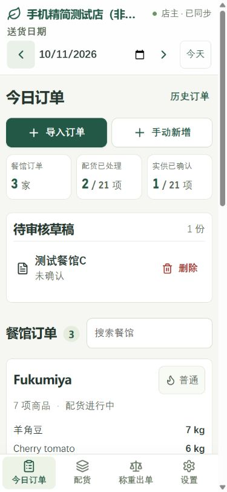
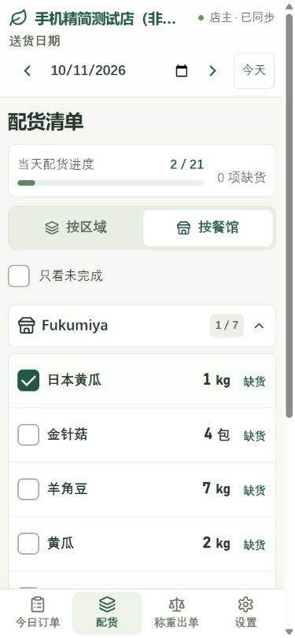
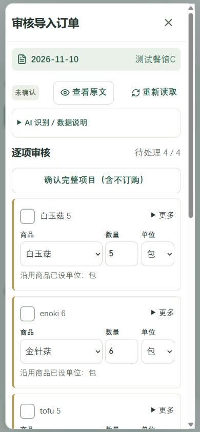
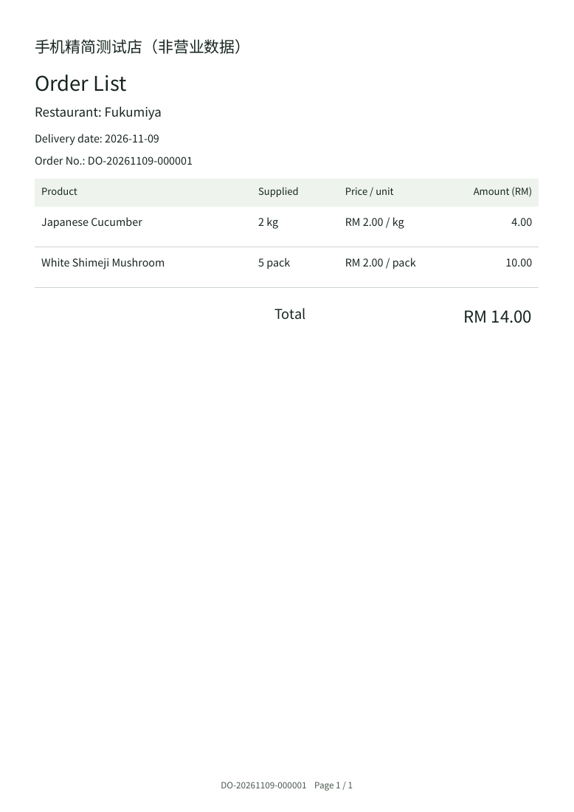
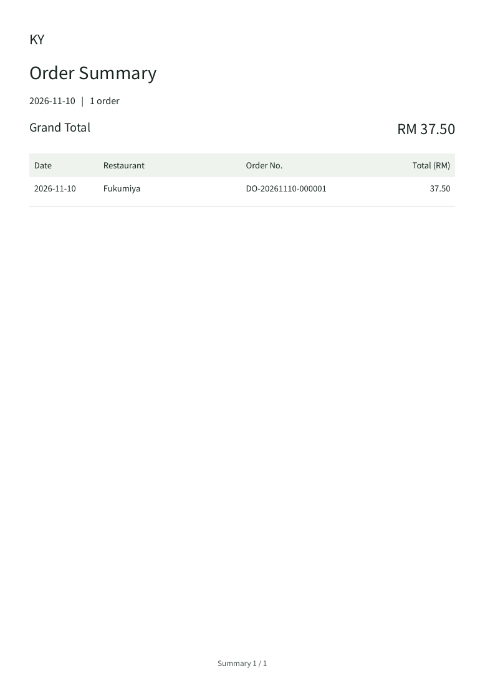
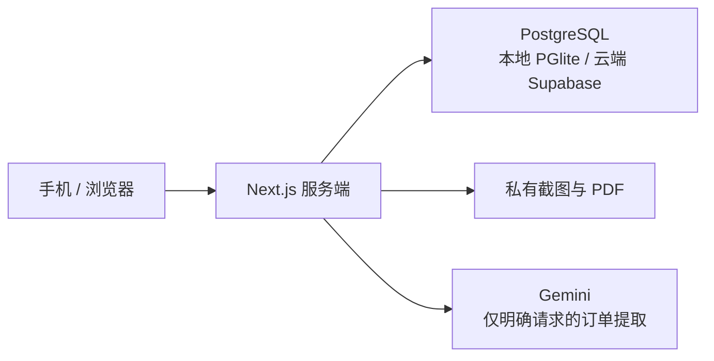

# ShopHelper · 鲜配助手

给小型鲜货店使用的手机订单、配货、称重与出单应用。

A mobile web app for restaurant orders, produce picking, weighing, and delivery documents.

把餐馆发来的文字或截图整理成订单，按区域或餐馆配货，再按实际供货数量计算金额、生成中英文 PDF。面向中文使用者，保留大按钮、简洁清单和可调字号，支持四人使用独立账号共同工作。

**文字 / 截图 → 人工审核 → 配货 → 实供确认 → Order List**

## 界面预览

以下均为隔离测试店的演示资料，不含真实营业订单或登录凭据。界面以中文操作；英文选项用于输出单据。

<table>
  <tr>
    <td align="center"><strong>今日订单</strong></td>
    <td align="center"><strong>配货清单</strong></td>
    <td align="center"><strong>导入审核</strong></td>
  </tr>
  <tr>
    <td></td>
    <td></td>
    <td></td>
  </tr>
</table>

<details>
<summary>查看英文送货单与日期汇总页</summary>

<table>
  <tr>
    <td align="center"><strong>英文 Order List</strong></td>
    <td align="center"><strong>合并 PDF 首页汇总</strong></td>
  </tr>
  <tr>
    <td></td>
    <td></td>
  </tr>
</table>

</details>

## 可以做什么

| 功能 | 使用方式 |
| --- | --- |
| 餐馆订单 | 按送货日期录单，维护商品、餐馆、区域和常用别名 |
| 文字与截图导入 | 简单文字先用规则解析；需要时明确调用 Gemini；文字和截图进入同一审核流程 |
| 人工审核 | 保留原文、原图；修改识别结果，逐项确认或明确不订购；草稿可删除、恢复 |
| 配货 | 按区域或餐馆查看；默认收起，点击展开；餐馆内是一张按区域顺序排列的清单 |
| 称重计费 | 配货与实供分别确认，按实际数量和订单价格快照计算金额 |
| 中英文单据 | 预览、下载、手动分享 A4 PDF；英文商品名由店主保存，缺少时提醒补填 |
| 历史合并 | 选择一天或日期范围，合并最新已定稿单据；默认第一页列出各单金额和总额 |
| 四人共享 | 独立账号、操作同步、权限控制；冲突时提示核对，保留未提交输入 |
| 备份恢复 | 导出完整业务 JSON，验证后恢复；保留历史价格、单据版本和原始 PDF |

界面保留标准 / 大字 / 特大三档字号，默认大字。配货清单的展开状态只影响当前手机，不改变其他人的显示或任务状态。

当前已实现单店共享的核心工作流（Stage 1–4）。Stage 5 的员工任务指派暂未实现；不支持断网后自动合并多台设备的写入。

## 日常流程

1. **设置资料**：建立区域、商品、单位、标准价格和餐馆；需要时设置餐馆专价、英文商品名及员工权限。
2. **导入订单**：选择送货日期和餐馆，手动录单，或粘贴文字、上传截图。
3. **核对确认**：对照原文 / 原图检查商品、数量和单位。确认前只是草稿，不进入配货清单。
4. **配货**：逐项勾选，或明确标记缺货。开始配货后，订购清单会锁定。
5. **确认实供**：输入实际重量或按件数量，处理缺价及重量差异提示。
6. **定稿出单**：最终核对后生成单据；选择中文或 English，再预览、下载或手动分享。

历史订单中可以复制订单、查看旧版本、按日期合并 PDF。已删除订单可以恢复；修订单据保留旧版，不能直接覆盖原始存档。

## 数量与金额规则

- **配货勾选不等于确认实供**；空白数量不等于零或缺货。
- 价格优先使用餐馆专价，再使用标准价；没有价格时显示待定价。零价是有效价格。
- 已确认订单保存价格快照，修改商品价格不会自动改掉旧订单。未定稿项目需要明确操作才读取现价。
- 只自动换算 `g` 与 `kg`。包、箱、粒、条、支等单位按已设规则处理，不猜每包或每箱的重量。
- 使用 Decimal 在服务端计算：逐行四舍五入到 RM 0.01，再合计，最后整单四舍五入到 RM 0.10。
- PDF 显示最终总额，内部仍保留小计和舍入调整。日期汇总直接相加每张单已保存的最终金额，不再舍入一次。
- 定稿后保存独立快照及原始 PDF；新单的英文商品名也随定稿保存。

例如：`2.08 kg × RM 6.00/kg = RM 12.48`；`300 g × RM 10.00/kg = RM 3.00`。整单 `RM 103.25` 最终为 `RM 103.30`。

## AI 导入与资料保护

AI 是可选的导入工具。没有配置 Gemini 时，仍可以手动录单和审核。

- 先用规则和已保存别名处理简单文字。商品只有一种已设订购单位时，可以补入缺省单位，并在审核中标注。
- Gemini 用于未解决的文字或用户明确发起的提取，不会在刷新、配货、称重、计费或生成 PDF 时调用。
- 截图按同一表格行读取商品和数量栏，支持中英马来文混排；例如 `pkt` 对应包、`pcs` 对应粒。
- 明确空白的数量栏归入待核对的“不订购”区；不可读、矛盾或缺失内容仍需人工处理，不会编造数量、商品或价格。
- API 失败或额度用尽时保留草稿，提供手动输入；没有无限自动重试或付费提供商自动切换。
- 识别结果和人工修改会保存，避免无意义地重复调用。单张截图支持 PNG / JPEG / WebP，上传上限 5MB；过长图片需要分段。

项目配置的模型是 `gemini-3.1-flash-lite`，通过服务端 `OrderExtractionProvider` 接口调用，可在重新验证支持范围和费用后替换。

**免费层资料使用须知**：Gemini unpaid service 的输入、输出可能用于产品或模型改进，并可能由人工审核。发送前应移除电话、个人资料及保密内容；不适合外传的订单请使用手动方式。应用会在识别前显示资料说明，原图保留在店铺私有存储中供核对。详见 [Google 服务条款](https://ai.google.dev/gemini-api/terms)。

所有密钥只放在服务端环境变量中，不使用 `NEXT_PUBLIC_*`，也不写入 Git、截图或业务备份。

## 本地启动

需要 **Node.js 24** 和 npm。下面的命令适用于 PowerShell：

```powershell
npm ci
if (!(Test-Path .env.local)) { Copy-Item .env.example .env.local }
npm run dev
```

打开 [http://127.0.0.1:3000](http://127.0.0.1:3000)。示例配置默认使用本地数据库，并关闭 AI。

本地首次启动时设置店名和店主密码，之后店主使用登录名 `owner` 登录。没有默认密码；员工账号由店主建立。已有安装请保留原来的 `.env.local` 和数据目录。

| 模式 | 数据保存位置 | 适用情况 |
| --- | --- | --- |
| 本地 `SHOP_BACKEND=local` | 单个 Node.js 服务进程 + PGlite 持久数据库 | 本机使用，或同一受信任局域网；电脑需要保持运行 |
| 云端 `SHOP_BACKEND=supabase` | Supabase PostgreSQL + 私有 Storage，Next.js 部署到 Netlify | 手机各自使用网络访问，不需要店内电脑一直开机 |

本地数据默认在 `data/postgres`，可用 `SHOP_DATA_DIR` 指定目录。同一 PGlite 目录只能由一个服务进程打开。`npm run dev:lan` / `npm run start:lan` 可提供局域网访问，详细步骤见 [DEPLOYMENT.md](DEPLOYMENT.md)。

如需 AI，在 `.env.local` 的服务端配置中填写 Developer API key，并确认项目没有启用 billing 后，再启用 `GEMINI_FREE_TIER_CONFIRMED`。本项目的每分钟 / 每日限制是应用保护上限，不是 Google 保证的额度。

## 云端部署与费用

云端方案使用 **Netlify + Supabase**，AI 另选 **Gemini Developer API**。本地运行无需云账号；云端需要对应平台账号及服务端环境变量。支持按免费套餐配置，但实际可用容量、配额和平台条款以各自控制台为准。

应用不会自动购买服务、开通 billing、充值、购买域名或切换付费模型。免费方案可能受到额度及服务可用性的限制，不等于永久无限使用。

- [CLOUD-SETUP.md](CLOUD-SETUP.md)：免费云端配置、私有存储、TLS、同步、迁移和英文名字段更新。
- [DEPLOYMENT.md](DEPLOYMENT.md)：本地 / 局域网部署和备份要求。
- [.env.example](.env.example)：可提交的空配置模板，不包含真实密钥。

云端使用 transaction pooler、跨实例事务锁及版本校验。同步主要传递轻量版本信息；隐藏或离线页面会停止连接，不持续轮询整份订单。

## 备份与共享权限

店主可管理商品、价格、员工和备份；员工默认可查看、配货和称重，录单 / 导入和 PDF 定稿权限分别授权。权限在服务端检查，修改权限或停用账号会撤销既有会话。

业务备份包含全部日期、目录、价格快照、原文、截图、已删除记录和单据版本，不包含登录密码、会话或 API key。备份含商务资料，应单独妥善保存。

恢复前会验证格式、关联、金额及 PDF 校验码，展示摘要，并要求确认替换；事务失败不会留下半套资料。当前安装的账号保留，恢复后需重新登录。支持可选的每日备份，默认未开启；备份位置和第二份备份的安排见部署文档。

## 技术结构

**Next.js 16 · React 19 · TypeScript · PostgreSQL / PGlite · Zod · Decimal.js · PDFKit · Sharp**



| 代码 | 职责 |
| --- | --- |
| [src/components](src/components) | 订单、导入审核、配货、称重、设置与历史界面 |
| [service.ts](src/lib/service.ts) | 业务操作、价格、权限及版本冲突处理 |
| [imports.server.ts](src/lib/imports.server.ts) | 草稿、提取、校验、审核和确认 |
| [gemini.server.ts](src/lib/gemini.server.ts) | 可替换的 Gemini 提取提供商 |
| [documents.server.ts](src/lib/documents.server.ts) | 定稿、历史快照与单据版本 |
| [pdf.server.ts](src/lib/pdf.server.ts) | 中英文 PDF、分页和金额汇总 |
| [backup.server.ts](src/lib/backup.server.ts) | 备份验证与事务恢复 |

PDF 在服务端本机生成，不需要外部 PDF 服务。中文字体及其 OFL 授权说明见 [assets/pdf-fonts](assets/pdf-fonts)。

## 检查与开发

```powershell
npm run typecheck
npm test
npm run build
```

`npm test` 使用 `test-results` 下的隔离数据库，覆盖金额边界、历史价格、备份恢复、导入审核、四会话并发和权限等。不会调用真实 Gemini；模拟提取测试不能替代真实图片识别效果的人工验收。

```powershell
# 可选：本机临时 PostgreSQL + 模拟 Storage，无需 Supabase 账号
npm run test:cloud
```

云端专项检查默认不包含在 `npm test` 内。不要把测试脚本指向营业数据库。四会话验收细节见 [STAGE4-TESTING.md](STAGE4-TESTING.md)。

### 只更新文档时，跳过 Netlify 部署

如果这次只改 README 和截图，提交说明加上 `[skip netlify]`：

```powershell
git add README.md docs/screenshots
git commit -m "docs: refresh README and screenshots [skip netlify]"
git push origin main
```

标记写在 **commit message**，不是写进 README 内容。它只用于这次纯文档提交；需要发布应用更新时不要加。参见 [Netlify 跳过部署说明](https://docs.netlify.com/deploy/manage-deploys/manage-deploys-overview/#skip-a-deploy)。
